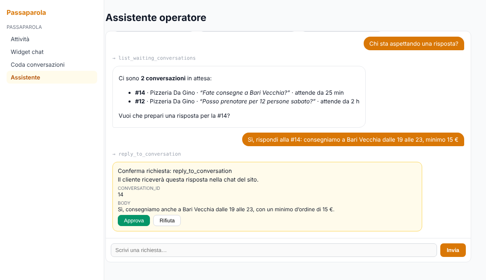

# Assistente operatore

L'assistente è una chat nel pannello di Passaparola. Gli chiedi, con parole tue, di fare quello che
di solito fai a mano nella coda: vedere chi aspetta, leggere una conversazione, preparare una risposta,
aggiungere una risposta alla base di conoscenza, guardare com'è andata la settimana.

Versione PDF: [operator-assistant.pdf](operator-assistant.pdf).

## Chi lo vede

| Utente | Vede il menu "Assistente"? | Su quali attività lavora |
|---|---|---|
| **Operatore** (membro di un'attività) | sì | solo le attività di cui è membro |
| **Titolare** (membro con ruolo titolare) | sì | le sue attività |
| **Amministratore** (`passaparola::admin` o super-admin) | sì | tutte le attività |
| Altri utenti registrati (non membri di nessuna attività) | no | nessuna |

L'assistente fa **solo** quello che puoi già fare tu nel pannello: usa gli stessi permessi della coda.
Se chiedi una conversazione di un'altra attività, ti risponde che non è accessibile.

## Come si usa, passo per passo

1. Nel menu a sinistra, gruppo **Passaparola**, apri **Assistente**.
2. Scrivi una richiesta in fondo alla pagina e premi **Invia**, oppure tocca uno dei suggerimenti
   ("Chi sta aspettando una risposta?").
3. La risposta arriva mentre viene scritta. Le righe grigie con la freccia (`→ list_waiting_conversations`)
   mostrano quali dati l'assistente sta consultando.
4. Quando l'assistente deve **fare** qualcosa che cambia i dati, si ferma e ti mostra una card gialla
   **Conferma richiesta** con il testo esatto che userà:
   - **Approva**: l'azione parte e l'assistente ti dice com'è andata;
   - **Rifiuta**: non succede nulla; puoi spiegargli cosa cambiare e riprovare.
   Finché non decidi, la chat resta in attesa.
5. Ricaricando la pagina inizi una conversazione nuova.

## Azioni che chiedono sempre conferma

| Azione | Cosa succede se approvi |
|---|---|
| Rispondere a un cliente | il cliente legge la risposta nella chat del sito, firmata come operatore |
| Chiudere una conversazione | il cliente non può più scrivere in quella conversazione |
| Salvare nella base di conoscenza | l'assistente del sito userà quella risposta con tutti i clienti |

Leggere la coda, una conversazione, la base di conoscenza o il report **non** chiede conferma: non cambia nulla.

## Esempi di richieste

- "Chi sta aspettando una risposta?"
- "Riassumi la conversazione 14."
- "Prepara una risposta alla 14: consegniamo a Bari Vecchia dalle 19 alle 23, minimo 15 €." (prima te la mostra, poi chiede conferma per inviarla)
- "Questa domanda arriva spesso: aggiungi alla base di conoscenza che il sabato siamo aperti fino alle 24."
- "Com'è andata questa settimana? Quali domande sono rimaste senza risposta?"

## Se qualcosa non va

| Messaggio | Cosa significa | Cosa fare |
|---|---|---|
| "Errore: Nessun fornitore AI configurato…" | mancano le chiavi del modello sul server | l'amministratore imposta `GROQ_API_KEY` o `OPENROUTER_API_KEY` nel `.env` |
| "Errore: HTTP 419" | la sessione è scaduta | ricarica la pagina |
| "Errore: HTTP 429" | troppe richieste in un minuto (limite 30) | aspetta un minuto |
| "Conversazione non trovata o non accessibile" | la conversazione non esiste o è di un'altra attività | controlla il numero nella coda |

## Per chi amministra

- Rotta: `POST /passaparola/operator-assistant/run` (sessione web, CSRF, 30 richieste al minuto).
- Modello: il primo fornitore con la chiave fra Groq e OpenRouter (`assistant_providers` del modulo AI).
- Conversazioni dell'agente nella tabella `ai_agent_messages`, run in attesa di conferma in `ai_agent_runs`.
- Lo stesso insieme di azioni è disponibile da Claude o Cursor tramite il [server MCP](mcp-server.md).
- Il client JS si ricompila con `npm install && npm run build` nella cartella del modulo; il file
  compilato `public/js/operator-assistant.js` è versionato (circa 670 KB, quasi tutto `zod`, richiesto da `@ag-ui/client`).
