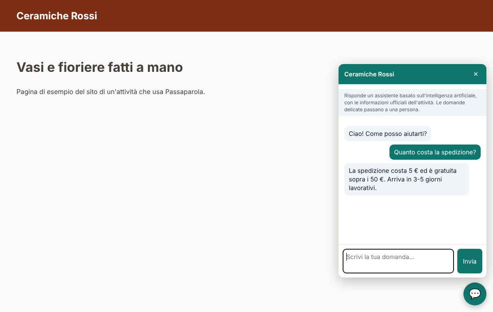

# Widget chat incorporabile

Il widget è la chat che compare sul sito dell'attività. Risponde l'assistente del modulo AI con la
base di conoscenza dell'attività; quello che è delicato passa a una persona.



*Interfaccia reale di `public/widget.js` su una pagina di prova; la risposta mostrata è un esempio
(lo screenshot è stato fatto senza server, con risposte finte).*

## Per chi parte da zero

1. Nel pannello **Passaparola → Widget chat** crea un widget per l'attività.
2. In **Siti ammessi** scrivi l'indirizzo completo del sito, per esempio `https://www.negozio.it`.
   Senza siti ammessi il widget non risponde: è voluto, così nessun altro sito può usarlo.
3. Apri il widget: in **Codice da incollare nel sito** c'è una riga come questa, da copiare prima di `</body>`:

   ```html
   <script src="https://<server>/assets/passaparola/widget.js" data-key="pp_..." data-lang="it" defer></script>
   ```

4. Ricarica il sito: in basso a destra compare il pulsante della chat.

## Tipi di utente

| Utente | Cosa fa |
|---|---|
| **Amministratore Passaparola** | Crea il widget, imposta i siti ammessi, consegna il codice |
| **Titolare / sviluppatore del sito dell'attività** | Incolla il codice nel sito |
| **Visitatore** | Fa domande; vede subito l'avviso che risponde un'AI |
| **Operatore** | Riceve le conversazioni passate a una persona (story 1.5) |

## Come funziona

| Passo | Dove |
|---|---|
| Il browser carica `widget.js` da `/assets/passaparola/` | `public/widget.js` (link `public_html/assets/passaparola`) |
| Chiede i testi nella sua lingua | `GET /api/passaparola/widgets/{publicKey}/config?lang=it` → `GetWidgetConfigAction` |
| Invia la domanda | `POST /api/passaparola/widgets/{publicKey}/messages` → `SendVisitorMessageAction` |
| Rilegge lo storico ogni 15 secondi a chat aperta (risposte dell'operatore) | `GET /api/passaparola/widgets/{publicKey}/conversations/{token}/messages` → `ListConversationMessagesAction` |

- **Sito ammesso**: ogni chiamata passa da `ResolveChatWidgetAction`, che confronta l'header `Origin`
  con `allowed_origins` (schema, host e porta). 404 se il widget o l'attività sono spenti, 403 se il sito non è ammesso.
- **Conversazione**: `FindOrStartConversationAction` riprende la conversazione del token del visitatore o
  ne apre una nuova con un thread AI (`CreateAiThreadAction` del modulo AI, `panel_id` = `passaparola-widget`).
- **Risposta**: `AnswerQuestionAction` del modulo AI con `Workspace::knowledgeCollection()` e le parole sensibili
  dell'attività. Se serve una persona la conversazione passa a `handed_off`.
- **Dopo il passaggio**: le domande successive **non** vanno all'assistente; restano nel thread
  (`AppendAiMessageAction`) e il visitatore riceve il messaggio di attesa.
- **Limiti**: 20 messaggi al minuto per IP, 60 letture al minuto; messaggi fino a 1000 caratteri.
- **Sicurezza del testo**: lo script mostra ogni messaggio con `textContent`, mai come HTML.
- **Privacy**: il token della conversazione resta nel `localStorage` del visitatore; nessun cookie.
  Le domande sono salvate in `ai_messages`: la conservazione è da definire (issue #8).

## Test

- `tests/Unit/Widget/ChatWidgetTest.php` (Pest): siti ammessi, chiavi e token, stati, ruoli, codice da incollare.
- `tests/js/widget.test.cjs` (Node + jsdom): apertura, invio, risposta mostrata come testo, token salvato, Esc.
  Esecuzione: `npm i --no-save jsdom@24 && node tests/js/widget.test.cjs`.

## Limiti noti

- Le risposte dell'operatore arrivano con un controllo ogni 15 secondi, non in tempo reale.
- Lingue del widget: italiano e inglese.
